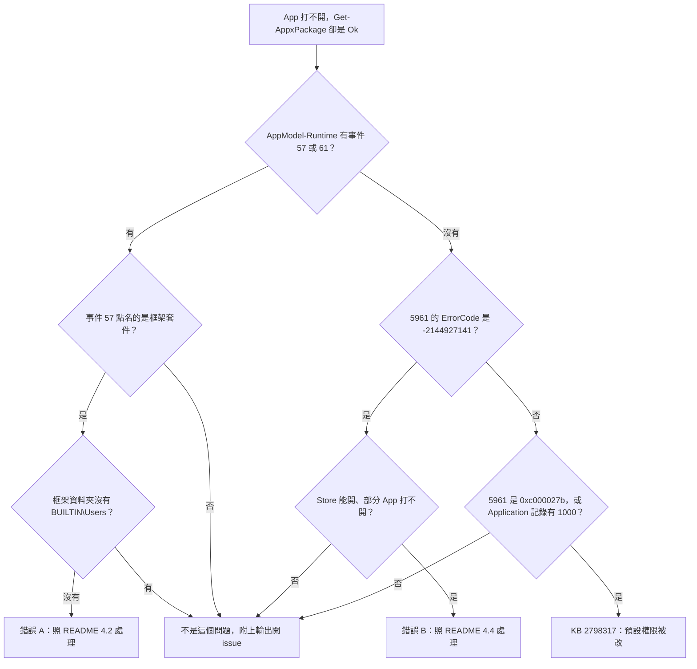

# 05 怎麼判斷是不是跟我一模一樣

[README 第三節](../README.md#三怎麼判斷是不是跟我一模一樣)是精簡版，這一份是完整版：每一項檢查，**看不到預期結果時代表什麼**，以及要怎麼處理。

先用管理員身分開 PowerShell：開始功能表輸入 `PowerShell` → 右鍵「Windows PowerShell」→「以系統管理員身分執行」。**不要用 PsExec 開的 SYSTEM 視窗，也不要用 32 位元的 PowerShell。** 兩個都要確認：

```powershell
whoami                              # <電腦>\<你的帳號>
[Environment]::Is64BitProcess       # True
```

## 判斷流程



## 檢查 1：時機與版本

**做什麼：** 用 `winver` 看 Windows 版本與 build。回想問題是什麼時候開始的。

**一模一樣：** Windows 10 專業版 22H2（build 19045）；問題在「重設此電腦（雲端下載、全部移除）」之後出現，或重設後沒有消失。

**看起來不同時：**

| 情況 | 代表什麼 |
|---|---|
| Windows 11 | 我們沒有在 Windows 11 驗證。機制可能相同，也可能不同 |
| 問題在某次更新後才出現 | 更新可能改了權限或套件，不一定是這個缺口 |
| 問題在你用過「最佳化」、「清理」或「隱私」軟體後出現 | 這類工具會改權限。本案例的缺口不是被改壞，而是條目從來沒有，兩者的處理不同 |
| 問題在你自己改過 `WindowsApps` 權限後出現 | 與本案例相反。見 README 3.3 與 4.8 |

## 檢查 2：App 已安裝，卻打不開

```powershell
Get-AppxPackage Microsoft.WindowsStore | Format-List Name, Version, Status, InstallLocation
```

**一模一樣：** `Status : Ok`，`InstallLocation` 在 `C:\Program Files\WindowsApps\` 底下。

**看不到時：**

| 情況 | 代表什麼 |
|---|---|
| 沒有輸出 | App 沒有註冊給這個使用者。這是另一個問題（沒有安裝）。可以先試 `Add-AppxPackage -Register` |
| `Status` 不是 `Ok`（例如 `NeedsRemediation`） | 套件狀態損壞，可先試 `Remove-AppxPackage` 與重新註冊 |

## 檢查 3：啟動時的錯誤

```powershell
Start-Process 'ms-windows-store:'
```

**一模一樣：** 回「無法執行這個命令，因為發生錯誤: 存取被拒」。

**看不到時：**

| 情況 | 代表什麼 |
|---|---|
| 跳出「您需要新的應用程式才能開啟此連結」 | 你很可能在 SYSTEM 視窗。換視窗 |
| 沒有錯誤，Store 視窗出現又消失 | 啟動鏈可能有別的失敗。繼續看檢查 4 |
| Store 能開 | 你可能沒有這個問題，或已經修好 |

## 檢查 4：事件 57、61、5961（關鍵）

```powershell
Get-WinEvent -LogName 'Microsoft-Windows-AppModel-Runtime/Admin' -MaxEvents 200 |
  Where-Object { $_.Id -in 57,61 } | Select-Object TimeCreated, Id, Message | Format-List

Get-WinEvent -LogName 'Microsoft-Windows-TWinUI/Operational' -MaxEvents 500 |
  Where-Object { $_.Id -eq 5961 } | Select-Object TimeCreated, Message | Format-List
```

**一模一樣（錯誤 A）：**

- 57：「抓取套件 … 資料夾的信任狀態失敗，狀態為 2147942405」，而且點名的是**框架**。
- 61：「無法建立套件 … 的處理程序，因為執行完整性檢查時發生錯誤。存取被拒。」
- 5961：「啟用失敗。錯誤碼: 存取被拒。啟用階段: COM ActivateExtension」

**看不到時：**

| 情況 | 代表什麼 |
|---|---|
| 沒有 57／61，5961 的錯誤碼是 `-2144927141` | 可能是錯誤 B（檢查 8） |
| 沒有 57／61，5961 的錯誤碼是 `0xc000027b` | KB 2798317 的情況 |
| 完全沒有這些事件 | 記錄可能被清掉或沒有啟用；先啟動一次再查 |
| 57 點名的是 App 本身，不是框架 | 資料夾權限的對象不同，可以用相同方法檢查那個資料夾，但我們沒有驗證 |
| 記錄名稱不存在 | 非 Windows 10／11 的相同版本，或記錄被停用 |

## 檢查 5：框架套件的安裝狀態（旁證）

```powershell
Get-AppxPackage -AllUsers | Where-Object { $_.IsFramework } |
  Select-Object Name, Architecture,
    @{n='狀態'; e={ ($_.PackageUserInformation | ForEach-Object { [string]$_ }) -join ' | ' }}
```

**這台機器的現象：** 約 20 個框架只有 `S-1-5-18: Staged`（SYSTEM），沒有使用者的 `Installed`。

**看不到時：** 沒有關係。**這不是必要條件。** 我們把它們註冊成 `Installed` 之後症狀完全沒變，所以它只是旁證，不能用它來決定要不要做修復。

## 檢查 6：權限對照（關鍵）

```powershell
$ok  = (Get-AppxPackage Microsoft.WindowsCalculator).InstallLocation
$bad = (Get-AppxPackage -Name Microsoft.UI.Xaml.2.8 | Select-Object -First 1).InstallLocation
"--- 正常 App"; icacls $ok
"--- 框架";     icacls $bad
```

**一模一樣：** 正常 App 的輸出有 `BUILTIN\Users:` 開頭的行；框架的輸出沒有，而且每一條條目都帶 `(I)`（繼承來的）。

**看不到時：**

| 情況 | 代表什麼 |
|---|---|
| 框架也有 `BUILTIN\Users` | 缺口不在這裡。可能是別的框架，或是別的問題。繼續看檢查 7 |
| 兩者都沒有 `BUILTIN\Users` | 這個資料夾的權限結構與我們看到的不同，無法套用 |
| `icacls` 對框架資料夾回「存取被拒」 | 你的視窗沒有提升，或你不是擁有者且沒有讀取權限。先確認視窗身分 |
| 你用的是中文系統，看不到 `BUILTIN\Users` 字樣 | 用 SID 找：`S-1-5-32-545`。`icacls` 的輸出有時顯示名稱，有時顯示 SID |

也可以用 [`scripts/Detect-FrameworkFolderAcl.ps1`](../scripts/Detect-FrameworkFolderAcl.ps1) 一次檢查全部框架（唯讀）。

## 檢查 7：Process Monitor（決定性）

完整步驟見 [06](06-fix-step-by-step.md) 的 1.3。

**一模一樣：**

- `Result` 是 `ACCESS DENIED`；
- `Process Name` 是 `svchost.exe`；
- `Operation` 是 `CreateFile`；
- `Path` 是 `C:\Program Files\WindowsApps\<框架套件>`；
- `Detail` 欄有 `Impersonating: <電腦>\<使用者>`。

**看不到時：**

| 情況 | 代表什麼 |
|---|---|
| 完全沒有 ACCESS DENIED | 你的篩選或操作有問題：只篩 `Result is ACCESS DENIED`、不加處理序條件；擷取時要真的點壞掉的 App |
| ACCESS DENIED 都來自 `explorer.exe`，路徑在登錄或 `WindowsApps` 根目錄 | 這是一般使用者不能列出 `WindowsApps` 的預設保護，是雜訊 |
| 拒絕的是別的程序或別的路徑 | 不是主因 A。把路徑與程序記下來，開 issue |
| 只有 `ApplicationFrameHost.exe` 被記錄 | 你的篩選限制了處理序。拿掉 |

## 檢查 8：修好 A 之後，是否進入 B

**一模一樣：**

- Store 能開了，但部分 App 仍打不開；
- 5961 的 `ErrorCode` 是 `-2144927141`（訊息「應用程式未啟動」，英文 "The app didn't start"）；
- 57、61 沒有了；
- 打不開的 App 都依賴 .NET Native（相片、Store 能開）。

**看不到時：**

| 情況 | 代表什麼 |
|---|---|
| 所有 App 都能開了 | 你只有錯誤 A，修好了 |
| 還有 57／61 | A 還沒修完，再抓一次 Procmon |
| 其他 App 失敗但 5961 是另一個錯誤碼 | 超出我們驗證的範圍 |

## 結果對照

| 符合哪幾項 | 判斷 | 去哪裡 |
|---|---|---|
| 4、6、7 都符合 | 錯誤 A | [06](06-fix-step-by-step.md) 的第 2 章 |
| A 修好後 8 符合 | 加上錯誤 B | [06](06-fix-step-by-step.md) 的第 4 章 |
| Store 能開但一直轉圈 | 代理軟體或網路 | [06](06-fix-step-by-step.md) 的第 6 章 |
| 只有 2、3 符合，沒有 57／61 | 不是這個問題 | README 3.3 的對照表 |

## 要開 issue 時，請附上

1. Windows 版本與 build（`winver`）。
2. 檢查 4 的事件輸出（去識別）。
3. 檢查 6 的 `icacls` 輸出（去識別）。
4. [`Detect-FrameworkFolderAcl.ps1`](../scripts/Detect-FrameworkFolderAcl.ps1) 的輸出。
5. 如果做了 Procmon：只貼 `svchost.exe` 的 `ACCESS DENIED` 那幾列。
6. 你做過哪些修復，以及結果。

去識別：電腦名稱、使用者名稱、SID 的後綴請改成 `<COMPUTER>`、`<USER>`、`S-1-5-21-<…>`。
